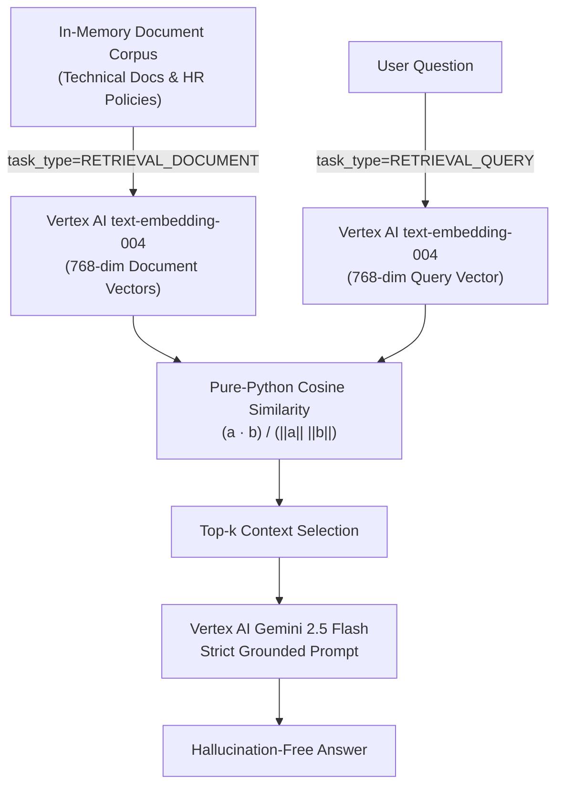

# 🧠 First-Principles Vertex AI RAG (`first-principles-vertex-rag`)


Zero-framework **Retrieval-Augmented Generation (RAG)** implementations built from first principles using **Vertex AI Task-Typed Embeddings (`text-embedding-004`)**, pure-Python cosine similarity math $\frac{\mathbf{a} \cdot \mathbf{b}}{\|\mathbf{a}\| \|\mathbf{b}\|}$, and **Gemini (`gemini-2.5-flash`)** — without LangChain, LlamaIndex, or external vector databases.

---

## 📐 Architecture



---

## 📁 Project Structure

```text
first-principles-vertex-rag/
├── main.py                 # Unified CLI entry point (--demo task-typed | hr-policy | all)
├── feature_simple_rag.py   # Asymmetric task-typed RAG (RETRIEVAL_DOCUMENT vs RETRIEVAL_QUERY)
├── feature_local_rag.py    # HR policy knowledge base RAG pipeline
├── simple_rag.py           # Standalone runner for task-typed RAG
├── local_rag.py            # Standalone runner for HR policy RAG
├── .env.example            # Environment variable template
├── requirements.txt        # Python dependencies
└── README.md               # Project documentation
```

---

## ⚙️ Environment Variables

| Variable | Required | Default | Description |
| :--- | :---: | :---: | :--- |
| `GCP_PROJECT_ID` | Yes | — | Google Cloud Project ID |
| `GCP_LOCATION` | No | `us-central1` | Vertex AI region |
| `EMBEDDING_MODEL` | No | `text-embedding-004` | Vertex AI embedding model |
| `GEMINI_MODEL` | No | `gemini-2.5-flash` | Vertex AI generative model |

---

## 🚀 Quickstart

```bash
git clone https://github.com/shubhamv3129/first-principles-vertex-rag.git
   cd first-principles-vertex-rag
python3 -m venv .venv
source .venv/bin/activate
pip install -r requirements.txt

cp .env.example .env
# Set GCP_PROJECT_ID in .env

gcloud auth application-default login
python3 main.py --demo all
```
